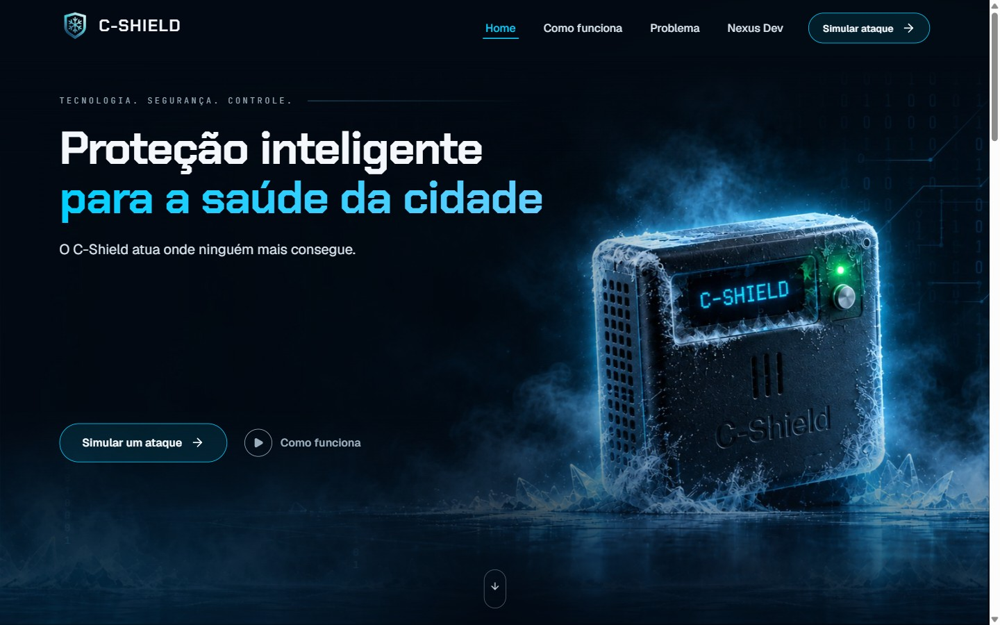
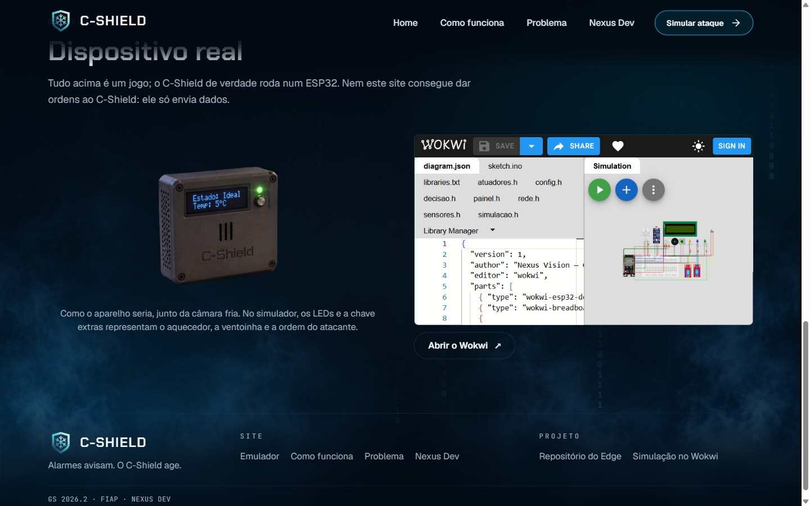
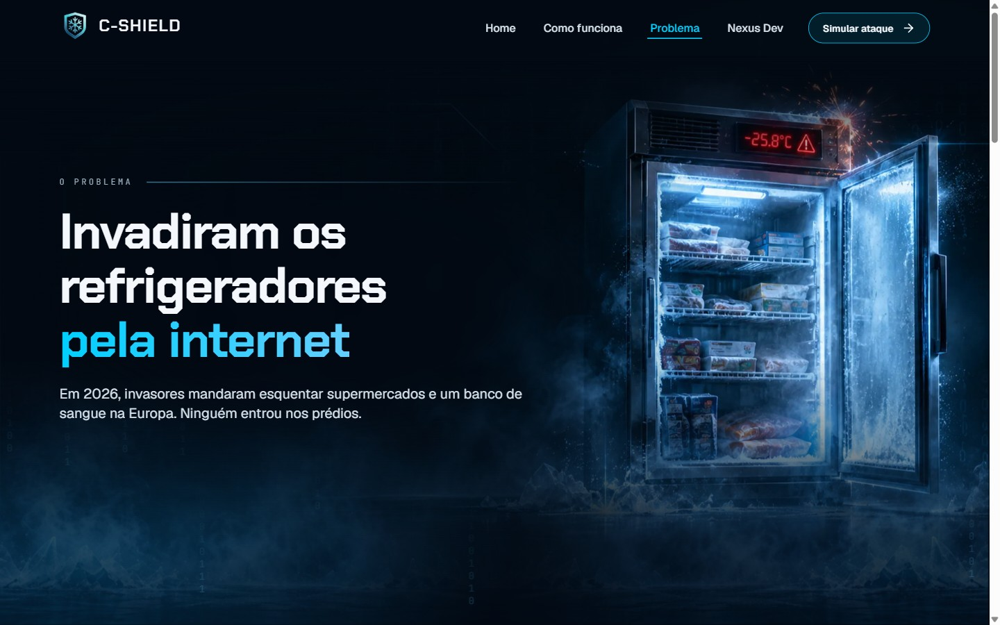

<a id="readme-top"></a>

<div align="center">

  

  <h1>C-Shield</h1>
  <h3>O site do escudo cibernético para câmaras frias</h3>

  <p>
    Um ESP32 entre o controlador e a geladeira, com sensores próprios e uma política gravada nele.<br>
    Se alguém invade o controlador e manda esquentar, o C-Shield percebe, assume o controle e avisa no local.<br>
    <strong>Alarmes avisam. O C-Shield age.</strong>
  </p>

  <p>
    <a href="https://c-shield-eight.vercel.app"></a>
    <a href="https://wokwi.com/projects/480328417992209409"></a>
    <a href="https://github.com/NexusDev-Team/C-Shield-Edge"></a>
  </p>

  <p>
    
    
  </p>

</div>

<br>

<details>
  <summary><strong>Sumário</strong></summary>
  <ol>
    <li><a href="#ficha-citizentech">Ficha CitizenTech</a></li>
    <li><a href="#sobre-o-site">Sobre o site</a></li>
    <li><a href="#telas">Telas</a></li>
    <li><a href="#funcionalidades">Funcionalidades</a></li>
    <li><a href="#feito-com">Feito com</a></li>
    <li><a href="#arquitetura">Arquitetura</a></li>
    <li><a href="#pré-requisitos">Pré-requisitos</a></li>
    <li><a href="#instalação-e-execução">Instalação e execução</a></li>
    <li><a href="#deploy">Deploy</a></li>
    <li><a href="#links">Links</a></li>
    <li><a href="#uso-de-ia">Uso de IA</a></li>
    <li><a href="#equipe">Equipe</a></li>
  </ol>
</details>

---

## Ficha CitizenTech

| Campo | Conteúdo |
| --- | --- |
| **Nome da CitizenTech** | C-Shield (de Cyber Shield) |
| **Equipe** | Nexus Dev: Isac Nilton Fernandes de Oliveira (RM 573282), João Benedito de Oliveira Simplício (RM 570206), Leonardo Formigari (RM 573291), Luis Fernando (RM 570959), Nicolas Cinel (RM 572940) |
| **Cidade** | São Paulo |
| **Cidadão beneficiado** | Quem depende do que está guardado no frio sem ver o equipamento: o paciente que precisa de transfusão, a criança que vai tomar vacina na UBS e a família que compra no mercado do bairro. Quem usa o C-Shield é o responsável pelo frio sem equipe de segurança: o dono do açougue, a farmacêutica, a enfermeira da sala de vacina. |
| **Problema, em uma frase** | Controladores de câmaras frias conectados à internet podem ser invadidos e mandados esquentar, e quem guarda vacinas, sangue e alimentos só descobre horas depois, quando o produto já está perdido. |
| **Como funciona** | Um ESP32 independente, instalado junto da câmara, mede a temperatura com sensores próprios e compara com uma política gravada nele. Diante de uma ordem perigosa, corta o aquecimento por um relé, trava novas ordens e avisa no local, mesmo sem internet. Ele não recebe comandos pela rede: só envia dados. A liberação é presencial, por um botão no aparelho. |
| **O que cada parte faz** | **Edge:** o C-Shield no Wokwi, publicando no FIWARE · **Python:** central que cadastra câmaras, avalia ordens recebidas e calcula a exposição térmica · **DPS:** modelo do aquecimento (lei de Newton) que mostra quanto tempo o produto aguenta e quanto o C-Shield evita perder · **Front e Web:** este site, com a página do problema, o emulador do ataque numa cidade de 5 locais, o circuito real no Wokwi e o cadastro de câmaras do bairro · **Experiência:** requisitos, caso de uso e protótipo · **Pitch:** a história e o negócio |
| **Links** | Repositório do site: [NexusDev-Team/WebFront-GS](https://github.com/NexusDev-Team/WebFront-GS) · Repositório do Edge: [NexusDev-Team/C-Shield-Edge](https://github.com/NexusDev-Team/C-Shield-Edge) · Wokwi: [projeto público](https://wokwi.com/projects/480328417992209409) · Site publicado: [c-shield-eight.vercel.app](https://c-shield-eight.vercel.app) |
| **Indicador de impacto** | Tempo entre o ataque e a resposta (na Europa, 3h30; com o C-Shield, segundos) · exposição térmica evitada (°C·min) · ordens perigosas bloqueadas |
| **ODS** | 3 Saúde e bem-estar · 9 Indústria, inovação e infraestrutura · 2 Fome zero |

<p align="right">(<a href="#readme-top">voltar ao topo</a>)</p>

---

## Sobre o site

O C-Shield (de *Cyber Shield*) é um dispositivo de borda que protege a câmara fria de ataques ao controlador comercial. Este site é a vitrine e o laboratório do projeto: explica o problema, deixa o visitante **ser o hacker** numa cidade simulada e mostra como o aparelho reage. É uma única aplicação, entregue em duas disciplinas da FIAP: Front-end Design e Web Development (Global Solution 2026.2).

> **O site nunca dá ordens ao C-Shield.** Não existe nenhuma ligação de rede entre o site e o dispositivo. A faixa segura de temperatura aparece só para leitura, com a etiqueta "gravada no dispositivo", e o bloqueio só termina presencialmente, no botão físico do aparelho.

<p align="right">(<a href="#readme-top">voltar ao topo</a>)</p>

---

## Telas

| Rota | O que mostra |
| --- | --- |
| `/` | Página inicial animada: o problema, a solução e uma prévia do ataque bloqueado |
| `/emulador` | Emulador "seja o hacker" com uma cidade de 5 locais, placar e, no fim, a seção "Dispositivo real" (Wokwi embutido e imagem do aparelho) |
| `/problema` | O contexto do caso (notícias) e o cadastro de câmaras do bairro, ligado à MockAPI |
| `/como-funciona` | O caminho de uma ordem perigosa até o bloqueio, e por que a comunicação é de uma direção só |
| `/nexus-dev` | A equipe e as tecnologias do projeto |
| `*` | Página 404 do próprio site |

Redirecionamentos: `/simulador-real` leva a `/emulador#dispositivo-real`; `/noticias` e `/incidentes` levam a `/problema`.

<p align="center">
  <br>
  <br>
  
</p>

<p align="right">(<a href="#readme-top">voltar ao topo</a>)</p>

---

## Funcionalidades

- **Emulador "seja o hacker":** cidade com 5 locais, ataques por botão e placar. O C-Shield do emulador reage com as mesmas regras do firmware.
- **Regras do firmware em JavaScript:** a lógica de decisão do Edge foi portada para `src/domain` e é coberta por testes do Vitest (372 testes).
- **CRUD completo de câmaras:** criar, listar, editar e excluir câmaras do bairro numa API externa (MockAPI), com filtro por tipo (vacina, plasma, insulina, congelado).
- **Dispositivo real:** o circuito do C-Shield no Wokwi embutido na página, ao lado da imagem de como o aparelho seria.
- **Página inicial animada:** canvas, SVG, `IntersectionObserver` e framer-motion.
- **Acessibilidade:** contraste mínimo de 4,5:1, `prefers-reduced-motion` respeitado, foco visível, nada pisca mais de 3 vezes por segundo e `aria-label` legível nos botões em leet (`4T4QU3` é lido como "Ataque").

<p align="right">(<a href="#readme-top">voltar ao topo</a>)</p>

---

## Feito com

- [React](https://react.dev) 19 (JavaScript puro, sem TypeScript)
- [Vite](https://vite.dev) 8
- [Tailwind CSS](https://tailwindcss.com) 4
- [react-router-dom](https://reactrouter.com) 7
- [framer-motion](https://www.framer.com/motion/), [recharts](https://recharts.org) e [lucide-react](https://lucide.dev)
- [Vitest](https://vitest.dev) para a lógica de domínio
- [MockAPI](https://mockapi.io) para o CRUD de câmaras
- [Vercel](https://vercel.com) para a publicação

<p align="right">(<a href="#readme-top">voltar ao topo</a>)</p>

---

## Arquitetura

```
src/
  pages/        uma página por rota
  components/   componentes de interface (só desenham e chamam hooks)
  hooks/        useCShield, useCidadeSimulada, useCamaras, useSegurar,
                useLeituraDemo, usePrefereMenosMovimento
  domain/       regras de negócio em funções puras e testadas
  services/     chamadas de rede (mockapi.js é o único que faz fetch)
  content/      textos e links do site
  assets/       imagens e logo
  styles/       estilos globais
tests/          testes do Vitest para src/domain e services
```

Regra das camadas: componente só desenha e chama hooks; regra de negócio fica em `src/domain`; rede fica em `src/services`. Nenhum componente faz `fetch` direto.

<p align="right">(<a href="#readme-top">voltar ao topo</a>)</p>

---

## Pré-requisitos

- Node.js 22 ou mais novo, com npm.
- Uma conta gratuita na [MockAPI](https://mockapi.io) com um projeto que tenha o recurso `camaras`, com os campos `nome`, `bairro`, `tipo`, `observacao` e `cadastradoEm`.

<p align="right">(<a href="#readme-top">voltar ao topo</a>)</p>

---

## Instalação e execução

```bash
git clone https://github.com/NexusDev-Team/WebFront-GS.git
cd WebFront-GS
npm install
cp .env.example .env     # no Windows (PowerShell): Copy-Item .env.example .env
```

Abra o `.env` e preencha a URL base da sua MockAPI, no formato abaixo:

```
VITE_MOCKAPI_URL=https://xxxx.mockapi.io/api/v1
```

Depois:

```bash
npm run dev        # servidor de desenvolvimento
npm test           # testes do domínio
npm run build      # build de produção
npm run preview    # serve o build localmente
```

<p align="right">(<a href="#readme-top">voltar ao topo</a>)</p>

---

## Deploy

O site é publicado na Vercel, importando este repositório do GitHub:

1. Em [vercel.com/new](https://vercel.com/new), importe `NexusDev-Team/WebFront-GS`. A Vercel detecta o Vite (build `npm run build`, saída `dist`).
2. Cadastre a variável de ambiente `VITE_MOCKAPI_URL` antes do primeiro deploy. Ela entra no site durante o build; se for adicionada depois, é preciso fazer um novo deploy.
3. O `vercel.json` devolve todas as rotas do React Router para o `index.html`, então atualizar a página em qualquer rota não dá 404.

Cada push na branch `main` publica uma nova versão automaticamente.

<p align="right">(<a href="#readme-top">voltar ao topo</a>)</p>

---

## Links

| Recurso | Link |
| --- | --- |
| Site publicado | [c-shield-eight.vercel.app](https://c-shield-eight.vercel.app) |
| Repositório do site | [github.com/NexusDev-Team/WebFront-GS](https://github.com/NexusDev-Team/WebFront-GS) |
| Repositório do Edge | [github.com/NexusDev-Team/C-Shield-Edge](https://github.com/NexusDev-Team/C-Shield-Edge) |
| Simulação no Wokwi | [wokwi.com/projects/480328417992209409](https://wokwi.com/projects/480328417992209409) |

<p align="right">(<a href="#readme-top">voltar ao topo</a>)</p>

---

## Uso de IA

As ferramentas de IA usadas, as interações, a validação e a análise crítica estão descritas em [AI.md](AI.md).

---

## Equipe

**Nexus Dev** · FIAP, Engenharia de Software, 1º ano

| Foto | Nome | RM |
| --- | --- | --- |
|  | Isac Nilton Fernandes de Oliveira | RM573282 |
|  | João Benedito de Oliveira Simplício | RM570206 |
|  | Leonardo Formigari | RM573291 |
|  | Luis Fernando | RM570959 |
|  | Nicolas Cinel | RM572940 |

<p align="right">(<a href="#readme-top">voltar ao topo</a>)</p>
